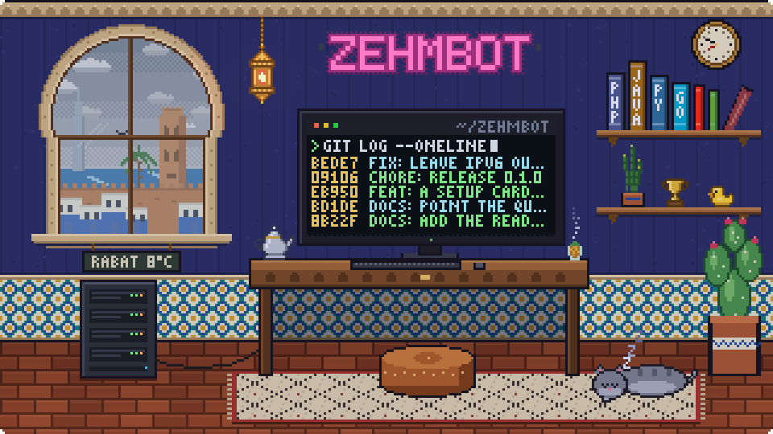
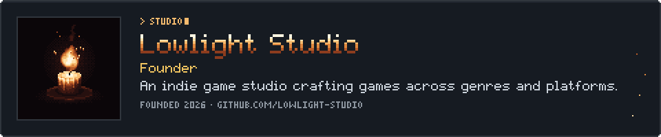
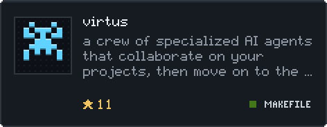
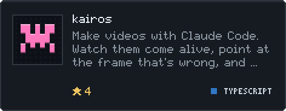
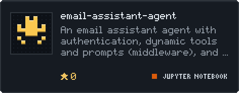
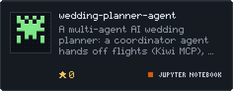
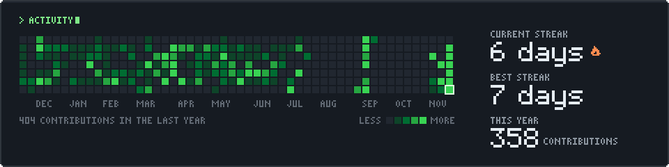

<p align="center">
  
</p>

<p align="center">
  <sub>The window shows the weather in Rabat right now · the monitor scrolls my latest commits · every book on the shelf is a language I write · the clock shows when the room was last redrawn</sub>
</p>

<p align="center">
  <a href="https://github.com/lowlight-studio">Lowlight Studio</a> ·
  <a href="https://www.linkedin.com/in/sabirbaichou/">LinkedIn</a> ·
  <a href="https://github.com/zehmbot?tab=repositories">Repositories</a>
</p>


<a href="https://github.com/lowlight-studio"></a>


<!-- pixel:projects:start -->


<p>
  <a href="https://github.com/zehmbot/virtus"></a>
  <a href="https://github.com/zehmbot/email-assistant-agent"></a>
  <a href="https://github.com/zehmbot/wedding-planner-agent"></a>
  <a href="https://github.com/zehmbot/personal-chef-agent"></a>
</p>
<!-- pixel:projects:end -->



<details>
<summary><code>$ cat whoami.php</code></summary>

```php
<?php
namespace Zehmbot;

final readonly class Engineer
{
    public function __construct(
        public string $fullName   = 'zehmbot',
        public string $city       = 'Rabat',
        public int    $age        = 24,
        public string $country    = 'Morocco',
        public string $email      = 'sabir.baichou@gmail.com',
        public array  $languages  = ['PHP', 'Java', 'Python', 'Go'],
        public array  $frameworks = ['Laravel', 'Spring Boot'],
    ) {
    }

    public function linkedIn(): string
    {
        return "https://www.linkedin.com/in/sabirbaichou/";
    }
}

$me = new Engineer();

```

</details>

<p align="center">
  
</p>

<!-- Every GIF above is drawn pixel by pixel by pixel/generate.py and refreshed by .github/workflows/pixel-profile.yml -->
